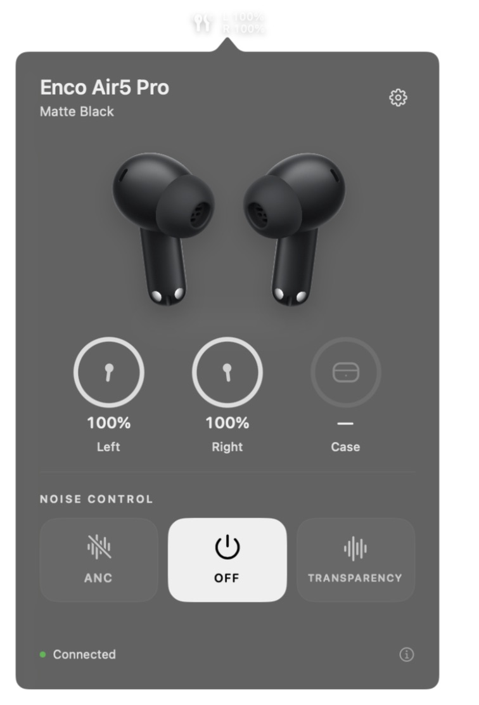
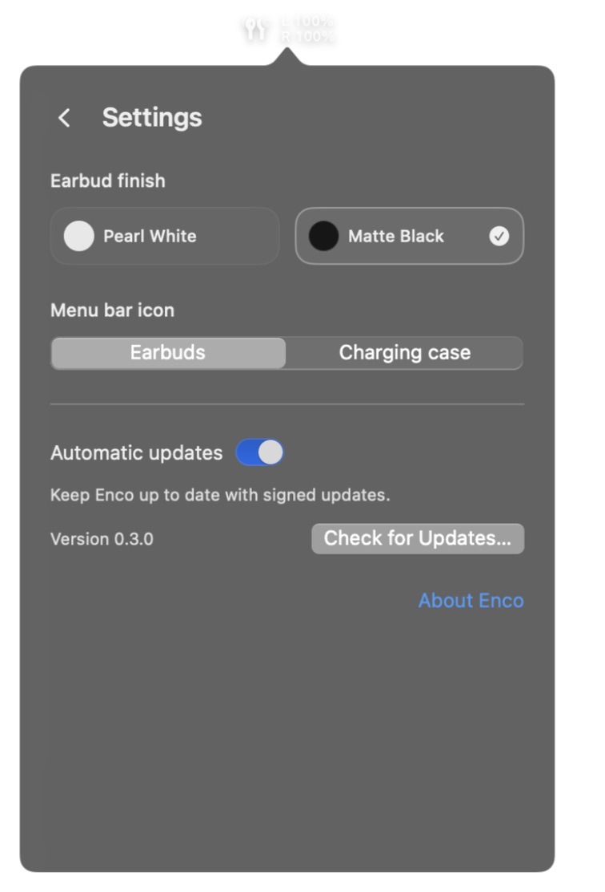

# Enco for macOS

A native macOS menu bar app for **OPPO Enco Air5 Pro**.

[Download for Apple Silicon](https://github.com/OutTuna/Enco-for-macOS/releases/latest) · [Original project](https://github.com/Vedant1521/Cracked-Oneplus_buds) · [My fork](https://github.com/OutTuna/Cracked-Oneplus_buds)

<p align="center">
  
  &nbsp;
  
</p>

After seeing the work in [Cracked-Oneplus_buds](https://github.com/Vedant1521/Cracked-Oneplus_buds), I created [my own fork](https://github.com/OutTuna/Cracked-Oneplus_buds) and decided to bring support for my OPPO earbuds to macOS. I followed the same approach as the original developer: an Android device with root access, Bluetooth HCI logs recorded while using the companion app, and analysis of the commands exchanged with the earbuds.

The work started in that fork. As it grew into a standalone app with its own interface and update channel, I moved it into a separate project. The original repository was the starting point; support for Air5 Pro required investigating its transport, packet format, commands, and state notifications.

## Features

- Lives in the macOS menu bar, without a persistent Dock icon.
- Switches between **ANC**, **OFF**, and **Transparency**.
- Reads the current listening mode and stays in sync with changes made through HeyMelody.
- Displays separate left and right battery levels in the panel and beside the menu bar icon.
- Offers white and black finishes using official product artwork, with opening and closing animations.
- Keeps Settings and About inside the menu bar panel, with back navigation.
- Lets you choose an earbuds or charging case menu bar icon.
- Supports update checks and signed automatic updates through Sparkle.

## Why I started this

I wanted to change noise cancellation and check battery levels from my Mac without reaching for my phone every time. The original OnePlus project showed a way to approach this, but I could not assume its commands would work unchanged with my OPPO earbuds.

My setup for the research was:

| Component | Setup |
| --- | --- |
| Mac | MacBook Air M3 |
| macOS | 15.8.1 |
| Earbuds | OPPO Enco Air5 Pro, CN region |
| Earbud firmware | 158.158.105 |
| Android device | POCO F3 with root access |
| Android system | LineageOS 24 / Android 17 |
| Companion app | HeyMelody 116.9.0 |

## Capturing the Bluetooth exchange

I enabled Bluetooth HCI snoop logging on the Android device and used HeyMelody to reproduce the actions I wanted on macOS: connecting, reading the current state, and switching listening modes.

Root access let me retrieve the Bluetooth logs from the system directory using ADB. On my device, the relevant files were:

```text
/data/misc/bluetooth/logs/btsnoop_hci.log.filtered
/data/misc/bluetooth/logs/btsnoop_hci.log.filtered.last
```

The `.filtered` files still contained the control traffic needed for this investigation. The exchange was then broken down into vendor packets so requests, replies, and unsolicited state notifications could be compared.

The HeyMelody APK was also examined with JADX to cross-check packet structures, capability handling, notification registration, and battery representations. This helped distinguish protocol fields from values that happened to appear in a particular capture.

Full HCI logs and decompiled APK sources are not included in this repository. Bluetooth captures can contain unrelated traffic, device names, and addresses. The project contains the client implementation and small protocol examples used for verification.

## What the protocol revealed

The verified Air5 Pro control connection uses **Bluetooth Classic / RFCOMM**. The macOS transport is implemented with `IOBluetooth`.

The vendor SDP service UUID is:

```text
0000079A-D102-11E1-9B23-00025B00A5A5
```

The observed connection used RFCOMM channel 5. The client resolves the channel through SDP rather than hardcoding it.

The control messages use an OPOv1 frame:

```text
AA | length:base128 | 00 00 | command:u16le | sequence:u8 | payloadLength:u16le | payload
```

Replies are matched to requests using the command and sequence number. The client checks lengths and response status, handles ordinary frames split across stream reads, and handles multiple frames received together. OPOv1's separate application-level fragmentation format is not currently supported; it was not needed for the verified commands.

During initialization, the client queries device capabilities, requests the supported event list, and subscribes to battery, device status, and listening mode notifications.

| Command | Purpose |
| --- | --- |
| `0x0100` | Query device capabilities |
| `0x0200` | Query supported events |
| `0x0205` | Register for multiple events |
| `0x0105` | Read component versions |
| `0x0106` | Read battery levels |
| `0x010C` | Read the current listening mode |
| `0x0404` | Set the listening mode |
| `0x0108` | Read gesture assignments |
| `0x010F` | Read the current EQ mode ID |
| `0x0122` | Read custom EQ profiles |

For the tested firmware, the `0x0404` payload starts with `01 01`, followed by the mode value:

| Mode | Value | Reported state mask |
| --- | --- | --- |
| ANC | `02` | `10 00` |
| OFF | `01` | `08 00` |
| Transparency | `04` | `00 01` |

I checked the actual behavior against HeyMelody on my phone. An early interpretation had the three mode labels shifted, even though the commands received successful replies. Comparing the real listening modes exposed that mistake, and both command mapping and state decoding were corrected. The client also reads the state back after a change rather than assuming the requested mode was applied.

## From a CLI to a menu bar app

The first working version was a Swift command-line client that connected to the earbuds, read their batteries, and changed listening modes. The protocol and RFCOMM transport were separated into `EncoCore` so the same implementation could support both the CLI and a graphical app.

Once that worked on my hardware, the project grew into a native menu bar app: a compact panel, separate battery indicators, listening mode controls, appearance settings, and an integrated About screen.

The interface uses official product renders with subtle entrance and exit animations. These are 2D assets rather than interactive 3D models. Artwork sources are listed in [ASSETS.md](ASSETS.md).

Updates use Sparkle with Ed25519-signed release archives. The public verification key is embedded in the app. Update signing is separate from Apple notarization: the current app builds are locally signed and are not notarized by Apple.

## Current limitations

The verified setup is **OPPO Enco Air5 Pro CN, firmware 158.158.105, on a MacBook Air M3 running macOS 15.8.1**. Other models, regions, firmware versions, and macOS releases have not been verified. The app targets macOS 13 or later, and the prepared builds are for Apple Silicon.

**Charging case battery:** an additional Android capture contained a notification reporting the case at 40%, alongside charging earbuds. That confirms the value can arrive through the earbuds' control connection. Reliable case battery reporting on macOS is still unresolved. The app shows a dash when no value is available.

**EQ and gestures:** read support exists in the CLI, but the graphical app does not yet provide a full editor for these settings.

An Android device with root access was used for research. The macOS app does not require an Android device or root access for normal operation.

## Verification

The protocol checks cover frame boundaries, split and combined stream reads, command encoding, request/reply matching, malformed packets, capability parsing, initialization, and listening mode readback. EQ and gesture data parsing are also covered.

I also checked live connections from the Mac and compared listening mode changes with HeyMelody on the actual earbuds. These checks document the behavior of the tested hardware; they do not establish compatibility with every OPPO or OnePlus model.

## Credits

Thanks to **Vedant Gupta** for [Cracked-Oneplus_buds](https://github.com/Vedant1521/Cracked-Oneplus_buds), which inspired this project and provided its starting point. [My fork](https://github.com/OutTuna/Cracked-Oneplus_buds), the retained project history, and the original `nordbuds.swift` preserve that connection. The original project declares the MIT license.

This is an independent community project, not an official OPPO or OnePlus application. Product artwork and trademarks belong to their respective owners.
